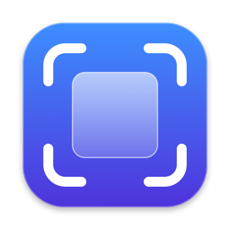
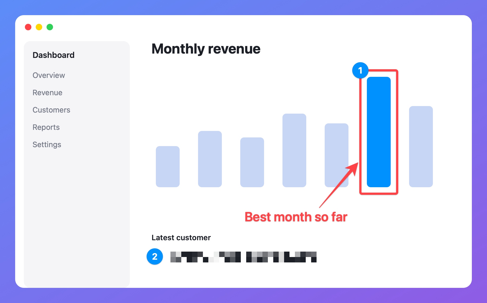
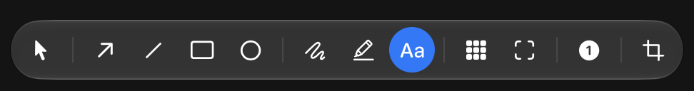
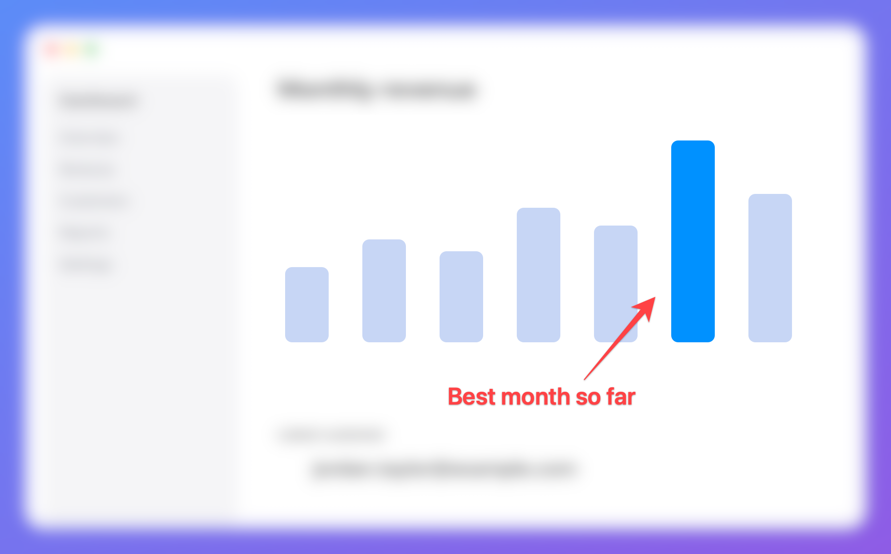

  

<h1 align="center">Qwikshot</h1>

  <strong>Capture, mark up and share your screen on Mac.</strong> 
  Free, open source, and built for macOS with Liquid Glass.

  
  
  
  

  

Qwikshot lives in your menu bar and replaces the built-in Mac screenshot tool. Press a shortcut, grab what you need, and it's on your clipboard, ready to paste. No account, no subscription, and your captures stay on your Mac.

## Features

- **Capture anything:** an area, a window, or the full screen. The screen freezes while you select, and a magnifier helps you line up the edges.
- **Instant preview:** a thumbnail appears after each capture, so you can copy, save, annotate or pin it, or drag it straight into another app.
- **Mark it up:** add arrows, lines, boxes, circles, freehand pen, highlights, text and numbered steps, then crop to fit.
- **Hide or highlight:** pixelate sensitive details, or blur everything outside the part that matters.
- **Record your screen:** save any area as an MP4, with optional mouse click highlights. Recordings don't include sound.
- **Copy text from anything:** select part of the screen and Qwikshot copies the text in it.
- **Pin to screen:** keep an image floating above your other windows for reference.
- **Recent captures:** your last 30 are one click away in the menu.
- **Automatic updates:** new versions install from inside the app.

### Annotate without leaving your flow

The editor keeps your image front and centre, with every tool in a floating palette. Each tool has a single-key shortcut, and everything you add can be moved or undone.

  

### Focus on what matters

Draw a rectangle with the Focus tool and everything outside it blurs. Your arrows and notes stay sharp.

  

> Focus is for drawing attention, not hiding secrets. Use Pixelate for anything private, and check the result before you share it.

## Install

1. Download the zip from the [latest release](https://github.com/alextana/qwikshot/releases/latest), unzip it, and move **Qwikshot** to your Applications folder.
2. Open it. Qwikshot isn't notarized by Apple, so macOS blocks it the first time. Go to **System Settings > Privacy & Security** and choose **Open Anyway**.
3. Press ⌘⇧4 and allow Qwikshot under **Privacy & Security > Screen & System Audio Recording**, then reopen the app.
4. Look for the viewfinder icon in your menu bar. Turn on **Open at login** in Settings to keep it ready.

### Replace the built-in screenshot tool

Qwikshot uses the same shortcuts as macOS, so turn the built-in ones off: go to **System Settings > Keyboard > Keyboard Shortcuts > Screenshots** and untick them.

## Shortcuts

| Shortcut | Action |
| --- | --- |
| ⌘⇧3 | Capture the screen under your cursor |
| ⌘⇧4 | Capture an area (Return selects the whole screen, Esc cancels) |
| ⌘⇧5 | Capture a window |
| ⌘⇧6 | Start or stop recording |
| ⌘⇧7 | Copy text from an area |

In the editor:

| Key | Tool | Key | Tool |
| --- | --- | --- | --- |
| V | Select | T | Text |
| A | Arrow | B | Pixelate |
| L | Line | F | Focus |
| R | Rectangle | N | Numbered step |
| O | Ellipse | C | Crop |
| P | Pen | H | Highlighter |

Hold Shift to draw squares and straight lines. ⌘Z undoes, ⇧⌘Z redoes, ⌘C copies and ⌘S saves.

## Privacy

Qwikshot has no accounts or analytics. The only time it goes online is to check for updates, and you choose whether that happens automatically. Captures are saved on your Mac: your last 30 in `~/Library/Application Support/Qwikshot/History`, and anything you save or record in the folder you pick in Settings, which is your Desktop by default.

## Contributing

Qwikshot is built with Swift, AppKit and SwiftUI. See the [development guide](docs/DEVELOPMENT.md) to build it from source.

## License

[MIT](LICENSE)
